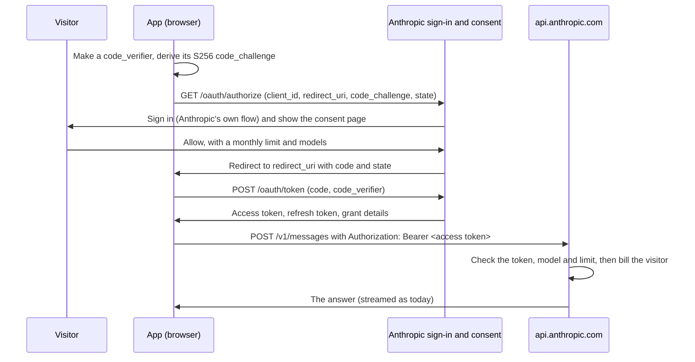

# Proposal: "Sign in with Anthropic" for third-party apps

**Status:** proposal by an independent developer, with a working local simulation. Anthropic doesn't offer this today, and nothing here is endorsed by Anthropic.

## Summary

Let a visitor connect their Anthropic API (Console) account to a third-party app through an Anthropic-hosted consent page. On that page the visitor sets a **monthly spend limit** and the **models** the app may use. The app receives a **scoped, revocable token** that works with the Messages API and is billed to the visitor's API credits. Anthropic enforces the limits. The visitor sees and revokes the connection in the Console.

Consumer subscriptions (Free, Pro, Max) are not part of this proposal. It covers API credits only.

## The problem today

An app that wants visitors to pay for their own Claude usage has one approved option: the visitor creates an API key and pastes it into the app. [`claude-byok-kit`](../README.md) makes that as safe as it can be, but the approach has limits that only Anthropic can remove:

- **Pasting keys is a habit phishing pages exploit.** A copied page can send the key anywhere, and visitors can't tell the difference.
- **A pasted key is all-or-nothing.** It can call any model, from anywhere, until it's deleted. The only cap is a Console workspace spend limit, and the visitor has to set that up by hand. The Default workspace can't have one.
- **The app has to trust its own code to keep limits.** Budgets enforced in the browser can be reset by reloading the page.
- **Most visitors give up.** Creating a workspace, setting a limit and copying a key is too much for anyone but developers.

## Goals

1. A visitor can let an app use Claude **without ever handling a key**.
2. **The visitor sets the limits** (monthly spend, models), and **Anthropic enforces them** on its servers.
3. A leaked token can cost **no more than the limit** the visitor chose.
4. The visitor can **see and revoke** every connection in the Console.
5. Apps use the **same Messages API and SDKs** as today. Only the credential changes.
6. Works for **browser apps with no backend**, as well as server and native apps.

## Non-goals

- Consumer subscriptions. They could be considered separately later.
- Access to anything besides inference: no Admin API, workspace settings, files of other apps, usage history or billing details.
- Paying apps or sharing revenue with them.

## Flow

The OAuth 2.0 authorization code flow with PKCE ([RFC 7636](https://www.rfc-editor.org/rfc/rfc7636)), as profiled by OAuth 2.1. There's no implicit flow and no client secret for browser apps. Hostnames and paths below are illustrative.



### 1. App registration (Console)

An app is registered once, by its developer, in the Console:

| Field | Purpose |
| --- | --- |
| Name, homepage, logo | Shown on the consent page. |
| Verified domain | Shown on the consent page. Anthropic verifies it, by DNS for example, so visitors can tell a real app from a copy. |
| Redirect URIs | Exact matches only. Their origins are the only origins allowed to use the app's tokens from a browser. |
| Requested models | The most the app can ask for. The visitor can allow fewer. |
| Suggested monthly limit | Pre-filled on the consent page. The visitor chooses the actual limit. |

The developer receives a public `client_id`. Server-side apps can also get a client secret; browser and native apps use PKCE alone.

### 2. Authorization request

```
GET https://platform.claude.com/oauth/authorize
  ?response_type=code
  &client_id=CLIENT_ID
  &redirect_uri=https%3A%2F%2Fapp.example%2F
  &code_challenge=BASE64URL(SHA256(code_verifier))
  &code_challenge_method=S256
  &state=RANDOM
  &scope=messages
```

- An unknown `client_id`, or a `redirect_uri` that isn't an exact registered match, shows an error page and **never redirects**.
- PKCE with `S256` and a `state` value are required. Other problems are reported by redirecting back with `error=invalid_request`.

### 3. Sign-in and consent

The visitor signs in **on Anthropic's own domain**, through Anthropic's normal sign-in. The consent page shows:

- the app's name, logo and **verified domain**;
- what the app can do (send Messages API requests billed to the visitor's credits) and what it can't (see keys, usage, settings or other apps);
- a **required monthly spend limit** in US dollars, pre-filled with the app's suggestion and capped by the organisation's own limits;
- the **models** the app asked for, each of which the visitor can untick;
- which organisation and workspace pays, when the visitor belongs to more than one. A good default is a new workspace per app, created automatically, so the existing workspace limits and usage reports apply unchanged.

*Deny* redirects back with `error=access_denied`. *Allow* redirects back with a one-time `code`, valid for about 60 seconds.

### 4. Token request

```
POST https://platform.claude.com/oauth/token
Content-Type: application/x-www-form-urlencoded

grant_type=authorization_code&code=CODE&redirect_uri=...&client_id=CLIENT_ID&code_verifier=VERIFIER
```

```json
{
  "access_token": "…",
  "token_type": "Bearer",
  "expires_in": 3600,
  "refresh_token": "…",
  "scope": "messages",
  "grant": { "id": "grant_…", "monthly_limit_usd": 5, "models": ["claude-haiku-5-5", "claude-sonnet-5-5"] }
}
```

- The token endpoint allows CORS from the app's registered origins, so browser apps need no backend.
- A code works once. A second attempt fails even when the first one did.
- Refresh tokens rotate on every use. If an already-used refresh token is presented again, the whole grant is revoked, because someone else must have a copy.

### 5. Calling the API

Requests are unchanged apart from the credential:

```
POST https://api.anthropic.com/v1/messages
Authorization: Bearer ACCESS_TOKEN
```

With the TypeScript SDK that's `new Anthropic({ authToken, dangerouslyAllowBrowser: true })` in a browser app, and every other SDK call stays the same.

Anthropic checks each request against the grant:

| Situation | Response |
| --- | --- |
| Token unknown, expired or revoked | `401 authentication_error` |
| Model not allowed by the visitor | `403 permission_error` |
| Browser request from an origin the app didn't register | `403 permission_error` |
| The request could take the month's spending past the visitor's limit | `402 billing_error` |
| Visitor's account out of credits | As today |

An app can show the visitor where they stand:

```
GET https://api.anthropic.com/v1/oauth/grant
→ { "app": "…", "month": "2026-10", "monthly_limit_usd": 5, "spent_usd": 0.42, "remaining_usd": 4.58, "models": […] }
```

### 6. Revocation

- **By the app** ("Disconnect"): `POST /oauth/revoke` with the token ([RFC 7009](https://www.rfc-editor.org/rfc/rfc7009)). It always answers 200.
- **By the visitor**: a **Connected apps** page in the Console lists every grant with its app, verified domain, models, this month's spending and limit, and a *Revoke* button. Revoking stops access and refresh tokens at once.
- **By Anthropic**: for an abusive app, revoking its `client_id` cuts off every grant it holds.

## Billing and limits

- Usage is billed to the visitor's organisation at normal API prices, through the workspace chosen at consent.
- The limit is per grant and per calendar month (UTC), and is enforced by Anthropic **before** a request runs. The simulation does this by reserving the request's worst-case cost (prompt plus `max_tokens`) and settling the real cost from `usage` afterwards. That way no single request can take a grant past its limit.
- The app never pays and never sees the visitor's balance, other usage or payment details.

## Security considerations

- **Phishing resistance:** sign-in only ever happens on Anthropic's domain, and the consent page shows a verified app domain. Apps never see a password or a key, so there's nothing to steal on a fake app page.
- **Blast radius:** a stolen token is limited to the grant's models and remaining monthly limit, and dies on revocation or refresh-token replay.
- **Origin binding:** browser requests carrying a token are accepted only from the app's registered origins. This doesn't stop a thief using a token from a server, but it does stop casual reuse on another website.
- **Short-lived access tokens**: about an hour, with rotating refresh tokens.
- **Consent page hardening:** it must never be framed (`frame-ancestors 'none'`), and its form posts must come from its own pages.
- **Rate limits** per grant and per app, in addition to the visitor's organisation limits.
- **Apps still need XSS hygiene.** A token in a compromised page can be used until revoked, but only within the grant.

## How this fits Anthropic's current terms

Anthropic's current developer terms forbid apps from offering Claude.ai login or routing requests through consumer subscription credentials, and expect usage to be billed to the owner of the credential. This proposal keeps both rules: every request is billed to the visitor's own API account, the app never holds the visitor's credentials, and consumer plans aren't involved. What it adds is a safe, Anthropic-controlled way to grant that access, instead of pasting keys.

## Prior art

- [OpenRouter's OAuth PKCE flow](https://openrouter.ai/docs/use-cases/oauth-pkce) lets users connect an OpenRouter account to an app, which receives a key tied to that user's credits.
- "Sign in with …" OAuth providers in general, and OAuth 2.1's profile of the authorization code flow with PKCE for public clients.
- Anthropic's own Console workspaces and spend limits, which this proposal reuses as the billing and enforcement unit.

## Open questions

1. Should each grant create its own workspace, or should visitors pick an existing one?
2. Should apps be able to request a *minimum* limit, to avoid grants too small to be useful?
3. How should verified domains, app review and abuse reports work?
4. Should there be an optional expiry ("disconnect after 30 days")?
5. Server tools such as web search have their own prices. Should they be separate scopes?

## Reference simulation

This folder holds a working local simulation of the whole flow: a stand-in for Anthropic's side (consent page, token endpoint, Messages API checkpoint with limits, grant info, revocation, Connected apps page) and a demo site that uses it. See [README.md](README.md).
